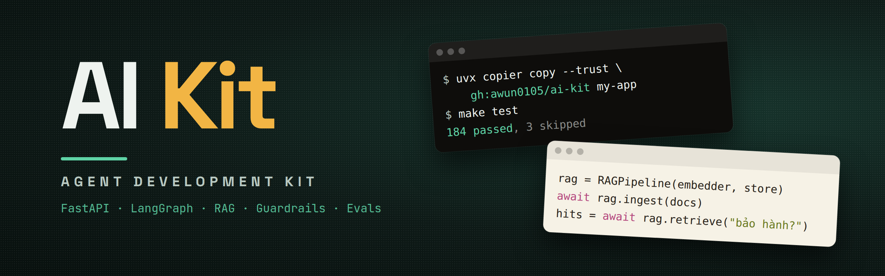

<a id="top"></a>



<div align="center">

[English: README_EN.md](README_EN.md)

**Toolbox (bộ công cụ) đã kiểm thử để làm ứng dụng LLM và agent, lắp sẵn thành một app FastAPI + LangGraph chạy được.**

[](https://github.com/awun0105/ai-kit/actions/workflows/ci.yaml)
[](LICENSE)
[](https://www.python.org/)

</div>

---

## Mục lục

- [Tổng quan](#tổng-quan)
- [Tính năng chính](#tính-năng-chính)
- [Cấu trúc kho mã nguồn](#cấu-trúc-kho-mã-nguồn)
- [Hướng dẫn bắt đầu](#hướng-dẫn-bắt-đầu)
- [Sử dụng nâng cao](#sử-dụng-nâng-cao)
- [Tài liệu hướng dẫn](#tài-liệu-hướng-dẫn)
- [Lời cảm ơn](#lời-cảm-ơn)
- [Bản quyền](#bản-quyền)

---

## Tổng quan

AI Kit gom những phần mà sản phẩm LLM nào rồi cũng cần: retrieval (truy xuất tài liệu),
guardrails (lớp bảo vệ), retry (thử lại) qua nhiều model, evaluation (đánh giá chất lượng) và
release pipeline (quy trình phát hành). Mỗi phần nằm trong một package (gói mã) riêng dưới
`app/services/`, có test chạy offline (không cần mạng hay API key) và một trang tài liệu. Phần
nào tốn tiền hoặc làm thay đổi hành vi thì tắt sẵn. Các phần đã được ghép thành một app agent
chạy được, nên project mới có thể bắt đầu từ cả app, hoặc chỉ lấy một phần lắp vào codebase
(mã nguồn) có sẵn.

## Tính năng chính

- **Agent core (lõi agent):** agent LangGraph lưu checkpoint (trạng thái hội thoại) trong Postgres, gọi tool (công cụ), human-in-the-loop (chờ người duyệt), long-term memory (bộ nhớ dài hạn) bằng mem0, session (phiên) JWT, rate limit (giới hạn tần suất), history budget (ngân sách lịch sử) và tùy chọn compaction (tóm tắt các lượt cũ).
- **RAG (trả lời dựa trên tài liệu):** ingest (nạp) md, txt, pdf, docx, html; hybrid search (tìm kiếm kết hợp) pgvector với BM25 có word segmentation (tách từ) tiếng Việt; reranker (xếp hạng lại) tùy chọn; câu trả lời có citation (trích dẫn) được kiểm tra.
- **Guardrails:** chặn prompt injection (chèn lệnh độc hại vào prompt) và PII (dữ liệu cá nhân) bằng tiếng Anh lẫn tiếng Việt, LLM rail (model phân loại theo chính sách) tùy chọn, approval (duyệt tay) cho tool rủi ro, egress allowlist (danh sách đích được phép gọi ra ngoài), redaction (che dữ liệu) ngay khi streaming (trả chữ dần).
- **Reliability (độ tin cậy):** một lớp retry duy nhất có retry budget (ngân sách thử lại), circuit breaker (ngắt mạch) cho từng model, fallback ladder (chuỗi model dự phòng), answer cache (bộ nhớ đệm câu trả lời) trả bản cũ khi nhà cung cấp gặp sự cố.
- **Tools và agents:** MCP client và server, A2A (giao tiếp giữa các agent) server và client, deep-research team (nhóm agent nghiên cứu sâu), `ResilientChatModel` dùng được cho mọi agent LangChain.
- **Evaluation:** golden set (bộ câu hỏi chuẩn) với retrieval metrics (chỉ số truy xuất), judge (model chấm điểm) riêng, tool trajectory (kiểm tra chuỗi tool được gọi), repeated runs (chạy lặp nhiều lần), simulated user (người dùng giả lập) hội thoại multi-turn (nhiều lượt) và gate (ngưỡng chặn) trong CI.
- **Delivery (phát hành):** Docker image chạy non-root (không dùng quyền root), đẩy lên GHCR sau khi scan (quét lỗ hổng) bằng Trivy, alert (cảnh báo) Prometheus, cost guard (giới hạn chi phí hằng tháng cho từng người dùng).

## Cấu trúc kho mã nguồn

| Đường dẫn | Nội dung |
|---|---|
| `app/services/` | Toolbox: `rag/`, `guardrails/`, `reliability/`, `evaluation/`, `mcp/`, `a2a/`, `agents/`, `cost_guard.py`, `compaction.py` |
| `app/core/kit.py` | Wiring (phần lắp ghép): dựng từng phần của toolbox từ settings (cấu hình); nơi duy nhất đọc settings |
| `app/core/langgraph/` | Graph của agent: input guard (kiểm tra đầu vào), chat, tool, output rail (kiểm tra đầu ra) |
| `app/api/v1/` | Route (đường dẫn API) cho auth (đăng nhập), chat và streaming |
| `scripts/` | `bootstrap`, `ingest`, `eval_rag`, `research` |
| `evals/datasets/` | Corpus (tài liệu mẫu), golden set và scenario (kịch bản hội thoại) |
| `tests/` | Test offline cho từng phần |
| `docs/` | Mỗi phần một trang; `ROADMAP.md` liệt kê tất cả |

## Hướng dẫn bắt đầu

Cần Python 3.13 trở lên, [uv](https://docs.astral.sh/uv/) và Docker.

1. Tạo project và chọn feature (tính năng): RAG, answer cache, LLM rail, reranker, MCP, A2A, deep research:

   ```bash
   uvx copier copy --trust gh:awun0105/ai-kit my-app
   cd my-app && git init
   ```

   Lệnh này tạo `.env.development` với JWT secret ngẫu nhiên và bật sẵn các tính năng đã chọn.

2. Cài đặt rồi chạy test offline (không cần API key):

   ```bash
   uv sync        # thêm --extra rerank / a2a / deep cho các tính năng đó
   make test
   ```

3. Điền `OPENAI_API_KEY` vào `.env.development`, rồi chạy API cùng Postgres và pgvector:

   ```bash
   make docker-up
   ```

4. Ingest tài liệu vào knowledge base (kho tri thức) rồi mở `http://localhost:8000/docs`:

   ```bash
   make ingest CORPUS=path/to/docs
   ```

<details>
<summary>Gửi request (yêu cầu) đầu tiên từ dòng lệnh</summary>

```bash
TOKEN=$(curl -s -X POST localhost:8000/api/v1/auth/register -H "Content-Type: application/json" \
  -d '{"email": "you@example.com", "password": "Secret123!", "username": "you"}' | jq -r .token.access_token)  # pragma: allowlist secret
SESSION=$(curl -s -X POST localhost:8000/api/v1/auth/session -H "Authorization: Bearer $TOKEN" | jq -r .token.access_token)
curl -X POST localhost:8000/api/v1/chatbot/chat -H "Authorization: Bearer $SESSION" \
  -H "Content-Type: application/json" -d '{"messages": [{"role": "user", "content": "Hello!"}]}'
```

</details>

Chạy trên máy mà không dùng Docker: xem [docs/getting-started.md](docs/getting-started.md).

## Sử dụng nâng cao

**Lấy một phần sang project khác.** Mỗi package dưới `app/services/` import được độc lập, không
kéo theo settings, database hay model registry (danh sách model) của app (`tests/test_toolbox_imports.py` kiểm tra
điều này). Copy package cùng các test đi kèm, rồi làm theo hai mục **Copy this module** và **When you
plug it in** trong trang tài liệu tương ứng. `app/core/kit.py` cho thấy app dựng phần đó từ settings
như thế nào.

**Cập nhật cải tiến mới của kit** vào project đã tạo bằng `uvx copier update --trust`.

**Đánh giá trước khi phát hành:** `make eval-rag-offline` kiểm tra retrieval mà không cần API key
(đây là gate trong CI); `make eval-rag` cho agent thật trả lời golden set và dùng một model làm
judge. Các tùy chọn như `--runs 3` và `--scenarios` có trong [docs/evaluation.md](docs/evaluation.md).

## Tài liệu hướng dẫn

Nên đọc [docs/ROADMAP.md](docs/ROADMAP.md) trước: danh sách các phần, trạng thái và nguồn gốc của
từng phần. Mỗi phần có trang riêng: [RAG](docs/rag.md), [guardrails](docs/guardrails.md),
[reliability](docs/reliability.md), [tools](docs/tools.md), [agents](docs/agents.md),
[evaluation](docs/evaluation.md), [conversation history](docs/compaction.md) (lịch sử hội thoại),
[deployment](docs/deployment.md) (triển khai). Settings nằm trong [docs/configuration.md](docs/configuration.md);
quy tắc viết code cho người và coding agent (agent viết code) nằm trong [AGENTS.md](AGENTS.md). Tài liệu chi tiết
hiện chỉ có bản tiếng Anh.

## Lời cảm ơn

- [fastapi-langgraph-agent-production-ready-template](https://github.com/wassim249/fastapi-langgraph-agent-production-ready-template) (MIT): base app (app nền).
- Các lab AI20K (VinUniversity): D08, D09, D11, D12, D14 (lời giải của tác giả) và D16, D18, D23, D24, D25 (đề bài).
- [Google ADK](https://github.com/google/adk-python): ý tưởng cho compaction và evaluation của agent, viết lại cho LangGraph.
- LangGraph, LangChain, deepagents, FastMCP, a2a-sdk, MarkItDown, underthesea, bm25s, rerankers, pgvector.

Trang tài liệu của từng phần ghi rõ file và commit gốc.

## Bản quyền

License (giấy phép) MIT, kế thừa từ template (mẫu dự án) gốc: xem [LICENSE](LICENSE). Để báo lỗi bảo mật, xem
[SECURITY.md](SECURITY.md).

---

<div align="center">

[Về đầu trang](#top)

</div>
