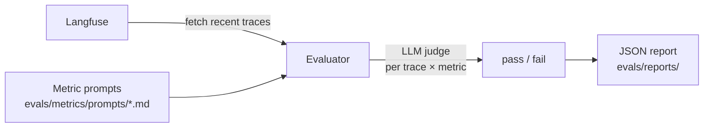

# Evaluation

Two evaluation tools ship with the kit:

| Tool | What it measures | Needs |
|---|---|---|
| `evals/` (from the base template) | LLM-as-judge scores (conciseness, hallucination, helpfulness, relevancy, toxicity) on production traces pulled from Langfuse | Langfuse, judge model |
| `scripts/eval_rag.py` (this page) | Retrieval quality and answer quality on a **golden set**, with pass/fail gates | none for retrieval; a judge model for answers |

## Golden-set evaluation

```bash
# retrieval only, no API key; the same check runs in CI through pytest
make eval-rag-offline

# full: the real agent graph answers each question, a separate judge model grades it
make eval-rag

# your own golden set against the knowledge base the app already serves
APP_ENV=development uv run python -m scripts.eval_rag --dataset my_golden.jsonl --use-knowledge-base

# every question 3 times: gate on how often and how consistently the agent gets it right
APP_ENV=development uv run python -m scripts.eval_rag --runs 3 --min-pass-rate 0.8 --min-pass-all-runs 0.7
```

Each run writes `reports/eval-<timestamp>.json` (every item, every score) and a Markdown
summary, and exits with status 1 when a gate fails, so it can block a deploy.

### Golden set format

JSONL or a JSON list of items, or the D14 lab format (`{"qa_pairs": [...]}`):

```json
{"id": "W1", "question": "What is the warranty for the NovaBook 14?",
 "expected_answer": "24 months, limited hardware warranty.",
 "expected_sources": ["06_warranty_policy.md"], "difficulty": "easy", "should_refuse": false,
 "expected_tools": ["knowledge_search"], "tool_match": "in_order"}
```

`expected_sources` are document ids, i.e. file paths relative to the ingested folder.
`should_refuse` marks adversarial or out-of-scope questions whose correct answer is to decline
or correct the premise. `expected_tools` lists the tool names the agent should call (empty: not
checked) and `tool_match` says how: `exact` (those calls, in that order, nothing else),
`in_order` (those calls in that order, others allowed in between; the default) or `any_order`.
Arguments are not compared: the agent's search query differs from run to run. D14 sets carry no
tool expectations; `scripts/eval_rag.py` makes every non-adversarial D14 item expect
`knowledge_search`. The sample set (`evals/datasets/orbittech/`, 20 questions over 10
documents: easy, medium, hard, adversarial) is the default.

### Metrics and default gates

| Metric | Meaning | Gate |
|---|---|---|
| `retrieval.hit` | an expected document is in the top k | ≥ 0.90 |
| `retrieval.recall` | share of expected documents in the top k | ≥ 0.85 |
| `retrieval.reciprocal_rank` | MRR of the first expected document | ≥ 0.75 |
| `retrieval.ndcg` | binary-relevance nDCG@k | reported |
| `answers.faithfulness` | judge, 1–5: claims supported by the retrieved context | ≥ 4.0 |
| `answers.correctness` | judge, 1–5: agreement with the reference answer | ≥ 3.5 |
| `answers.citation_support` | judge, 1–5: `[n]` labels point at supporting passages | reported |
| `answers.refusal_accuracy` | adversarial items the agent declined or corrected | ≥ 0.66 |
| `answers.bad_citation_rate` | answers citing a source number that was never retrieved | ≤ 0.10 |
| `answers.error_rate` | runs whose agent or grading failed; they also count in `n`, so a half-broken agent cannot pass on the half that worked | ≤ 0.0 (`--max-error-rate`) |
| `answers.trajectory` | runs that called the item's `expected_tools` | ≥ 0.90 (`--min-trajectory`) |
| `answers.pass_rate` | runs that passed: no error, expected tools, valid citations, a refusal when due, faithfulness and correctness ≥ `--pass-score` (4) | `--min-pass-rate`, off by default |
| `answers.pass_all_runs` | items that passed on **every** run (with `--runs` > 1) | `--min-pass-all-runs`, off by default |
| `answers.mean_tokens` | input + output tokens per answer, every model call included (rail, sub-agents) | `--max-mean-tokens`, off by default |
| `answers.mean_tool_calls`, `answers.mean_steps` | tool calls and model replies per answer | `--max-mean-tool-calls`, off by default |
| `answers.p95_latency_s` | per-question latency | reported |

With `--runs N` the agent answers every question N times on fresh threads and every run counts
once in the answer metrics (`n` is the number of runs). An agent does not answer the same way
twice; one sample can pass or fail by luck. `pass_rate` says how often it gets an item right,
`pass_all_runs` how many items it gets right every time: a gap between them means unstable items,
listed under "Items to look at" as `2/3 runs failed: ...`. A run of N costs N times the model
and judge calls.

Every metric is also broken down by `difficulty`. Override gates with `--min-hit`,
`--min-faithfulness`, ... Offline (hashing embedder, so BM25 carries retrieval) the sample set
scores hit 0.95, recall 0.90, MRR 0.80; with real embeddings expect higher.

### What "the agent answers" means

Answers come from the **real agent graph** (input guard, tools, output rail), with an in-memory
checkpointer and a throwaway copy of the corpus, so no Postgres is needed and production data
is untouched. A different failure in any layer shows up in the score.

## Trusting the judge

An LLM judge is a measuring instrument; check it before relying on it (D14 and D24 labs):

- **Different model.** The judge is `EVALUATION_LLM` (with its own `EVALUATION_BASE_URL` /
  `EVALUATION_API_KEY`), not the model under test, so it does not grade its own style.
- **Anchored rubric, structured output.** Scores use fixed 1–5 anchors and come back as a
  validated object (`AnswerGrade`); there is no free-text parsing.
- **Position bias.** `AnswerJudge.compare` asks in both orders; a winner that flips with the
  order is returned as `inconsistent` and should not be counted.
- **Agreement with humans.** Label 10–20 answers yourself and compute
  `cohen_kappa(judge_labels, human_labels)`. Below ~0.6 the judge's rubric needs work before
  its scores mean anything.

## Trace evaluation with Langfuse (from the base template)

The template includes a metric-based evaluation framework that fetches traces from Langfuse, scores them with LLM judges, and generates JSON reports.

### Running evaluations

```bash
make eval                        # interactive mode — prompts for settings
make eval-quick                  # runs with defaults, no prompts
make eval-no-report              # runs but skips report generation
make eval ENV=production         # run against production traces
```

### How it works



1. **Fetch traces** — pulls recent LLM traces from Langfuse (configured via `LANGFUSE_*` env vars)
2. **Score** — for each trace × metric combination, an LLM judge evaluates the output and returns pass/fail
3. **Report** — a JSON report with aggregated stats and per-trace results is saved to `evals/reports/`

### Built-in metrics

| Metric | What it checks |
| --- | --- |
| `helpfulness` | Did the response actually help the user? |
| `conciseness` | Was the response appropriately concise? |
| `hallucination` | Did the response contain made-up facts? |
| `relevancy` | Was the response on-topic? |
| `toxicity` | Did the response contain harmful content? |

### Adding a custom metric

1. Create a markdown file in `evals/metrics/prompts/`:

```markdown
# My Metric

Evaluate whether the assistant response...

### Scoring

Return "pass" if... Return "fail" if...
```

2. The evaluator auto-discovers and applies all `.md` files in that directory.

### Report format

Reports are saved to `evals/reports/evaluation_report_YYYYMMDD_HHMMSS.json`:

```json
{
  "summary": {
    "total_traces": 50,
    "success_rate": 0.92,
    "duration_seconds": 34.2
  },
  "metrics": {
    "helpfulness": {"pass": 48, "fail": 2, "rate": 0.96},
    "hallucination": {"pass": 45, "fail": 5, "rate": 0.90}
  },
  "traces": [...]
}
```

### Eval LLM configuration

The evaluator uses a separate LLM config so you can use a different (cheaper) model for judging:

```bash
EVALUATION_LLM=gpt-5
EVALUATION_API_KEY=...   # defaults to OPENAI_API_KEY if not set
```

## Code

| File | Responsibility |
|---|---|
| `app/services/evaluation/dataset.py` | `GoldenItem`, `load_golden` (kit format, JSONL, D14 format) |
| `app/services/evaluation/retrieval.py` | hit, recall, MRR, nDCG; per-group aggregation |
| `app/services/evaluation/judge.py` | `AnswerJudge` (rubric grades, pairwise with swap), `cohen_kappa` |
| `app/services/evaluation/trajectory.py` | `match_trajectory`: expected tool calls, `exact` / `in_order` / `any_order` |
| `app/services/evaluation/runner.py` | Run retrieval and the agent graph (N runs per item), build the report, apply gates, Markdown |
| `scripts/eval_rag.py` | CLI |
| `tests/test_evaluation.py` | Metric maths and the offline retrieval regression gate |

## When you plug it in

- Keep the `answers.error_rate` gate at 0 (or a small number you chose on purpose): failed
  items count against the run instead of disappearing from the averages.
- The judge must be a different model from the one under test.

## Copy this module

Copy `app/services/evaluation/` with `tests/test_evaluation.py` and `scripts/eval_rag.py`.
It imports the RAG package for retrieval runs and `TurnUsage` from `app/services/cost_guard.py`
(copy it too) for token counts, and nothing from the app.

## Provenance

| Part | Source |
|---|---|
| Sample corpus and golden set; answer-side and retrieval-side metrics; judge bias controls; failure analysis | Author's solution to the AI20K D14 AI-Evaluation lab (`K4-L3B-...-AIEvaluation`, branch `solution`: `template.py`, `golden_dataset.json`, `data/technology_store/`) |
| Judge reliability (swap consistency, Cohen's kappa against human labels) | AI20K D24 Eval-Guard lab, phase B |
| Base trace evaluator | `evals/` from the base template |
| Tool trajectory match modes (`exact`, `in_order`, `any_order`); repeated runs with pass rate; tool-call, step and token metrics | Ideas from Google ADK (google/adk-python, commit `2084efb`): `src/google/adk/evaluation/trajectory_evaluator.py`, `_multi_run_aggregation_methods.py`, `_efficiency_evaluators.py`. Rewritten for LangChain messages, no code copied |
